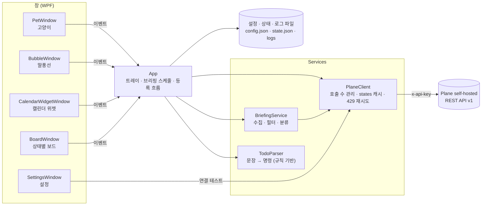
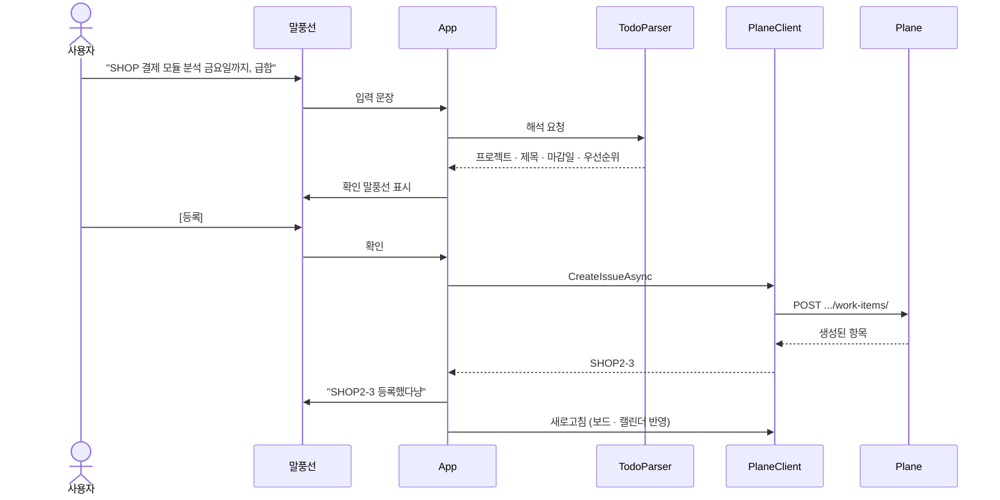

<div align="center">

# 🐱 Catcretary

**말을 걸면 할 일을 등록해 주는 데스크톱 고양이 비서**

Plane(self-hosted) 작업을 문장 한 줄로 등록·완료·검색하고,<br/>
매일 아침 내 담당 작업을 정리해 알려주는 Windows 트레이 앱입니다.


[주요 기능](#주요-기능) · [빌드·실행](#빌드실행) · [시스템 구조도](#시스템-구조도) · [기술적 의사결정](#기술적-의사결정) · [트러블 슈팅](#트러블-슈팅) · [문서](#문서)

</div>

---

## 프로젝트 소개

Catcretary 는 바탕화면에 떠 있는 작은 고양이입니다. 고양이를 눌러 `SHOP 결제 모듈 분석 금요일까지, 급함` 처럼
평소 말하듯 쓰면, 프로젝트·제목·마감일·우선순위를 해석해 Plane 에 작업 항목으로 등록합니다.

매일 정해진 시각에는 내 담당 작업을 마감 순으로 정리해 말풍선으로 알려주고, 새로 배정된 항목과 남이 단 댓글도
함께 알려줍니다. 마감일은 바탕화면에 붙는 **월간 캘린더 위젯**에서, 진행 상황은 **상태별 보드 위젯**에서 바로 확인합니다.

Plane 서버가 사내망에 있으면 클라우드에서 도는 자동화로는 접근할 수 없습니다. 그래서 수집·알림·등록을 모두
PC 에서 도는 로컬 앱이 맡습니다. LLM 은 쓰지 않으며, 문장 해석은 규칙 기반입니다.

| 항목 | 내용 |
|---|---|
| 버전 | `0.3.0` (`Catcretary.csproj` 의 `Version`). 변경 이력은 [`CHANGELOG.md`](CHANGELOG.md) |
| 대상 | Plane self-hosted Community `1.4.2` (`GET /api/instances/` 의 `current_version`) |
| 플랫폼 | Windows, .NET 8 (`net8.0-windows`) |
| 규모 | C# 소스 21개, XAML 7개. 외부 패키지 없음 |
| 연동 방식 | Plane REST API v1 (`x-api-key`). 키 호출 제한 분당 60회 |
| 설정 위치 | `%APPDATA%\Catcretary\config.json` |
| 로그 위치 | `%APPDATA%\Catcretary\logs\yyyy-MM-dd.log` (7일 보관) |

## 프로젝트 목표

| 목표 | 구현 |
|---|---|
| **등록 비용을 문장 한 줄로** | 웹을 열어 프로젝트·날짜·우선순위를 하나씩 고르는 대신, 문장을 쓰고 확인 말풍선에서 한 번 누르면 등록됩니다 |
| **찾아보지 않아도 알게** | 브리핑 시각에 고양이가 먼저 알려줍니다. 마감 지난 항목이 남아 있는 동안에는 빨간 배지를 답니다 |
| **항상 보이는 일정** | 캘린더와 보드가 바탕화면 층에 붙어 있어, 다른 창을 가리지 않고 바탕화면을 보면 바로 보입니다 |
| **서버에 부담을 주지 않게** | 분당 60회 제한 안에서 조회와 쓰기 몫을 나눠 쓰고, 바뀌지 않는 값은 캐시합니다 |
| **설치가 가볍게** | NuGet 패키지 없이 BCL 만으로 빌드되고, 단일 실행 파일로 배포할 수 있습니다 |

## 기술 스택

| 분류 | 사용 기술 |
|---|---|
| Language / Runtime | C# (`Nullable` 활성), .NET 8 (`net8.0-windows`) |
| UI | WPF (고양이, 말풍선, 위젯, 보드, 설정 창), WinForms `NotifyIcon` (트레이) |
| HTTP / JSON | `HttpClient`, `System.Text.Json` |
| Windows 연동 | `user32.dll` P/Invoke (바탕화면 층 고정), `HKCU\...\Run` (자동 실행), 시스템 테마 감지 |
| 달력 | `KoreanLunisolarCalendar` (음력), 자체 구현 공휴일·대체공휴일 계산 |
| 외부 API | Plane REST API v1 |
| Tooling | PowerShell (`tools/make-icon.ps1`, 스프라이트 → 다중 크기 `.ico`) |
| 글꼴 | `Pretendard` (PC 에 설치돼 있어야 함). 없으면 `맑은 고딕` |

## 주요 기능

### 1️⃣ 고양이에게 말 걸기

입력 말풍선에 쓴 문장을 아래 순서로 판정합니다. 쓰기 명령은 모두 **확인 말풍선에서 누른 뒤에만** Plane 에 반영됩니다.

| 종류 | 예 |
|---|---|
| 할 일 등록 | `SHOP 결제 모듈 분석 월요일부터 금요일까지, 급함 #분석 이번 사이클에` |
| 항목 명령 | `SHOP2-3 완료`, `SHOP2-3 시작`, `SHOP2-3 취소`, `SHOP2-3에 메모: 로그인 오류 재현 필요`, `SHOP2-3 열어` |
| 검색 | `로그인 오류 찾아줘`, `검색 결제 모듈` |
| 브리핑 | `오늘 뭐 해야 해?`, `브리핑` |
| 프로젝트 생성 | `새 프로젝트 BLOG3 만들어줘, 식별자 BLOG3, 템플릿 SHOP2, 별칭 블로그 BLOG-III` |

```
"SHOP 쇼핑몰 결제 모듈 분석 금요일까지, 급함"
  → 확인 말풍선: 프로젝트 [SHOP-II] 쇼핑몰 리뉴얼 / 제목 "결제 모듈 분석" / 마감 9/25 (금) / 우선순위 긴급
  → [등록] → Plane POST (담당자 = 나) → "SHOP2-3 등록했다냥"
```

날짜는 `오늘` `내일` `금요일` `다음 주` `N일 후` `M/D` `이번 달 말` 등을, 우선순위는 `급함` `중요` `천천히` 등을 인식합니다.
전체 문법은 [동작 규격 — 말 걸기](docs/behavior.md#말-걸기)에 있습니다.

### 2️⃣ 아침 브리핑과 새 소식

- 설정한 시각이 지나면 그날 한 번, 고양이가 뛰면서 요약 한 줄을 띄웁니다. 늦게 켠 날에도 첫 판정에서 바로 뜹니다.
- 내 담당 미완료 항목을 **새로 배정 → 마감 지남 → 오늘 마감 → 이번 주 마감 → 진행 중 → 우선순위 높음 → 그 외** 순으로 분류합니다.
- 목록에서 ✓ 를 누르면 완료 처리되고, 줄을 누르면 기본 브라우저로 Plane 페이지가 열립니다.
- 지난 브리핑 이후 **남이 수정한 항목과 새 댓글**을 찾아 항목 아래에 표시하고, 주기 새로고침에서 새로 생기면 말풍선으로 알립니다.

### 3️⃣ 바탕화면 캘린더 위젯

- 미완료 항목을 월간 달력에 그립니다. 시작일~마감일을 막대 하나로 이어 그리는 기간 표시와, 이번 주를 가운데 둔 5주 보기를 지원합니다.
- **막대를 다른 날 칸으로 끌면** 기간 길이를 유지한 채 시작일·마감일이 함께 옮겨집니다.
- 음력, 한국 공휴일, 대체공휴일을 표시합니다. 2024~2027년 공휴일표와 대조해 일치를 확인했습니다.
- 진행 중인 cycle 기간을 칸 아래 띠로 표시합니다.
- Plane 을 조회하는 동안 제목 줄의 새로고침 아이콘이 돕니다. 보드도 같습니다.
- 밝게 / 어둡게 / Windows 설정 따라감 테마, 배경 투명도, 글자 크기, 위치·크기 고정을 우클릭 메뉴에서 바꿉니다.

### 4️⃣ 상태별 보드 위젯

- 프로젝트 하나를 고르면 그 프로젝트의 state 가 열이 되고, `모든 프로젝트` 를 고르면 state 그룹 5개(백로그 / 할 일 / 진행 중 / 완료 / 취소)가 열이 됩니다.
- **카드를 다른 열로 끌면** 상태가 바뀝니다. 카드를 누르면 그 자리에서 제목·우선순위·날짜·담당자·라벨을 수정합니다.
- 각 열 아래 `＋ 새 작업 항목` 으로 그 열의 상태로 바로 항목을 만듭니다. 입력 칸이 열린 채로 다음 항목을 계속 받습니다.
- Plane 웹(1.4.2 Community)의 workspace 보기는 표 레이아웃만 제공하므로, 여러 프로젝트를 상태별·달력으로 한 번에 볼 때 이 보드와 위젯을 씁니다.

### 5️⃣ 살아 있는 고양이

| 상태 | 언제 |
|---|---|
| `Listening` | 입력·확인 말풍선이 열려 있을 때 |
| `Thinking` | Plane 호출 중 |
| `Done` | 등록·완료 처리 직후 (점프) |
| `Alert` | 마감 지난 담당 항목이 남아 있는 동안 (빨간 배지) |
| `Walk` | 6~14초마다 45% 확률로 제자리 좌우 ±140px 안을 산책 |
| `Sleep` | 6분간 아무 조작이 없으면. 클릭·말풍선·브리핑에 깹니다 |
| `Scared` | 드래그로 들어 올리는 동안 |

캐릭터가 그려지지 않은 픽셀은 클릭이 뒤 창으로 통과합니다. 말풍선 문구는 전부 고양이 말투("~냥")입니다.
전체 상태 표는 [동작 규격 — 캐릭터 상태](docs/behavior.md#캐릭터-상태)에 있습니다.

## 빌드·실행

```powershell
dotnet build
$exe = ".\src\Catcretary\bin\Debug\net8.0-windows\Catcretary.exe"
& $exe                                          # 고양이 + 트레이만
& $exe --show                                   # 시작하자마자 브리핑 말풍선
& $exe --say "SHOP 결제 모듈 분석 금요일까지, 급함"   # 시작하자마자 이 문장을 말한 것으로 처리
```

첫 실행 시 설정이 비어 있으면 설정 창이 먼저 뜹니다. 서버 주소·워크스페이스 slug·API 키를 넣고 `연결 테스트` 로 확인한 뒤 저장합니다.
내 계정은 API 키 주인(`GET /api/v1/users/me/`)으로 정해지므로 이메일은 받지 않습니다.

### 고양이 스프라이트와 아이콘

스프라이트 PNG 는 에셋 라이선스가 재배포를 금지하므로 저장소에 없습니다. 없어도 빌드와 실행은 되고, 코드로 그린 임시 고양이가 뜹니다.
스프라이트를 쓰려면 [`Assets/pet/README.md`](src/Catcretary/Assets/pet/README.md) 대로 PNG 를 받아 넣은 뒤 아이콘을 한 번 만듭니다.

```powershell
powershell -File tools\make-icon.ps1        # Assets\pet\app.ico 생성 (idle 첫 프레임, 16~256px 7단계)
```

`app.ico` 가 없으면 기본 아이콘으로 빌드되고, 트레이는 코드로 그린 도형을 씁니다.

### 배포용 단일 실행 파일

```powershell
dotnet publish src\Catcretary -c Release -r win-x64 --self-contained false `
  -p:PublishSingleFile=true -p:BundleSprite=false -o publish
```

`-p:BundleSprite=false` 는 PC 에 스프라이트가 있어도 PNG 와 `app.ico` 를 배포본에서 뺍니다. 에셋이 재배포 금지이므로,
남에게 전달하는 배포본은 이 옵션으로 만듭니다. 이 빌드는 임시 고양이와 도형 트레이 아이콘으로 동작합니다.
본인 PC 에서만 쓸 빌드는 옵션을 빼면 스프라이트가 함께 복사됩니다.

## 시스템 구조도

### 구성 요소

창들은 Plane 을 직접 호출하지 않고 이벤트로 `App` 에 요청합니다. `App` 이 `PlaneClient` 를 만들어 호출하고, 결과를 각 창에 나눠 줍니다.



### 할 일 등록 흐름



### 저장소 구성

```
Catcretary.sln
CHANGELOG.md                      버전별 변경 이력
LICENSE                           MIT
docs/                             상세 문서 (동작 규격, Plane API, 설정, 남은 확인 사항)
src/Catcretary/
├── App.xaml / App.xaml.cs        트레이, 고양이·말풍선 연결, 브리핑 스케줄, 등록 흐름
├── Pet/
│   ├── PetWindow.xaml(.cs)       투명 최상위 캐릭터 창. 클릭/드래그, 상태 전환, 우클릭 메뉴
│   ├── BubbleWindow.xaml(.cs)    말풍선. 메시지 / 입력 / 등록 확인 / 범용 확인 / 항목 목록 5개 모드
│   └── SpriteAnimator.cs         manifest.json 기준 스프라이트시트 프레임 재생
├── Board/
│   └── BoardWindow.xaml(.cs)     바탕화면 상태별 보드 위젯(Kanban)
├── Widget/
│   ├── CalendarWidgetWindow.xaml(.cs)  바탕화면 월간 캘린더
│   ├── DesktopPin.cs             바탕화면 층 고정 (Z 순서 맨 아래, Alt+Tab 제외, 소유자 Progman)
│   ├── KoreanCalendar.cs         음력 변환, 한국 공휴일·대체공휴일 계산
│   └── WidgetPalette.cs          밝게/어둡게/시스템 테마 색
├── Services/
│   ├── PlaneClient.cs            REST v1 클라이언트. states 캐시, 분당 호출 수 관리, 429 재시도
│   ├── BriefingService.cs        수집 → 내 담당·미완료 필터 → 분류, 새 배정·새 소식·진행률·cycle
│   ├── TodoParser.cs             문장 → 명령 (규칙 기반)
│   ├── AppConfig.cs              설정·상태 파일 입출력
│   ├── AppLog.cs                 날짜별 파일 로그, 7일 지난 파일 삭제
│   ├── AutoStart.cs              HKCU Run 키 등록/해제
│   └── TrayIconFactory.cs        트레이 아이콘을 코드로 그린다
├── Models/                       Plane REST 응답 DTO, 브리핑 모델
├── Themes/Controls.xaml          우클릭 메뉴·ComboBox·체크박스·스크롤바 테마 스타일
├── Views/                        설정 창, 값 변환기, 새로고침 아이콘 회전
└── Assets/pet/                   manifest.json, 에셋 안내 (PNG 는 저장소 미포함)
tools/
└── make-icon.ps1                 스프라이트 셀 → 다중 크기 app.ico
```

## 기술적 의사결정

**1️⃣ 클라우드 자동화 대신 로컬 앱**

- **문제**: Plane 서버가 사내망에 있어, 클라우드에서 도는 자동화로는 접근할 수 없습니다.
- **결정**: 수집·알림·등록을 모두 사용자 PC 의 트레이 앱이 맡습니다. 별도 서버를 두지 않습니다.

**2️⃣ LLM 대신 규칙 기반 문장 해석**

- **결정**: `TodoParser` 가 날짜·우선순위·라벨·cycle 표현을 규칙으로 뽑아내고, 남은 부분을 제목으로 씁니다. 외부 서비스로 작업 내용이 나가지 않고, 같은 문장은 항상 같은 결과가 나옵니다.
- **대가**: 별칭에 없는 표현은 프로젝트를 찾지 못하고 되묻습니다. `projectAliases` 로 별칭을 늘려 보완합니다.

**3️⃣ 분당 60회 제한 안에서 조회와 쓰기 몫 분리**

- **문제**: API 키는 분당 60회로 제한됩니다. 새로고침 한 번이 프로젝트 수에 비례해 호출을 쓰므로, 한도를 다 쓰면 등록·수정이 막힙니다.
- **결정**: 프로세스 전체의 요청을 1분 창으로 세고, 조회는 48회, 쓰기는 58회까지 보냅니다. 조회가 한도를 다 써도 쓰기 몫이 남습니다. states 는 6시간 캐시하고, 작업 목록은 `fields=` 로 필요한 필드만 받습니다.

**4️⃣ workspace 전체 질의 대신 프로젝트별 조회**

- **문제**: 대상 self-hosted 빌드에는 workspace 전체를 PQL 로 질의하는 엔드포인트가 없습니다(404).
- **결정**: 프로젝트별로 작업 목록을 받은 뒤 앱에서 내 담당·미완료를 필터합니다. 진행률도 이미 받은 항목으로 계산해 추가 호출이 없습니다.

**5️⃣ 화면을 먼저 바꾸고 서버에 반영**

- **결정**: 캘린더 막대 끌기와 보드 카드 끌기는 화면을 먼저 바꾼 뒤 `PATCH` 를 보내고, 실패하면 되돌립니다. 쓰기 1.5초 뒤 그 프로젝트 항목만 다시 받고, 마지막 쓰기 30초 뒤 전체를 다시 조회해 서버와 맞춥니다.

**6️⃣ 바탕화면 층에 고정되는 위젯**

- **결정**: `WS_EX_TOOLWINDOW` 로 Alt+Tab 에서 빼고, 소유자를 바탕화면 창(`Progman`)으로 지정하고, `WM_WINDOWPOSCHANGING` 에서 Z 순서를 항상 맨 아래로 돌립니다. 다른 창을 가리지 않으면서 바탕화면에서는 항상 보입니다.

**7️⃣ 댓글은 항목마다 따로 확인**

- **문제**: 댓글은 항목의 `updated_at` 을 바꾸지 않습니다(서버 소스 확인). 목록 응답만으로는 새 댓글을 알 수 없습니다.
- **결정**: 마감이 가까운 순으로 최대 20건만 항목별 최근 댓글 5개를 조회합니다. 조회 몫이 8회 미만으로 남으면 댓글 확인을 멈추고 다음 새로고침으로 미룹니다.

상세 규격은 [Plane API 연동](docs/plane-api.md)에 있습니다.

## 트러블 슈팅

**1️⃣ 브리핑이 403 으로 실패**

- **원인**: 프로젝트 목록은 내가 멤버가 아닌 공개 프로젝트까지 돌려주지만, 그런 프로젝트의 `states`·`work-items` 는 403 입니다.
- **해결**: 목록 응답의 `is_member` 가 `false` 인 프로젝트는 조회하지 않습니다.

**2️⃣ 탐색기가 재시작되면 위젯이 사라짐**

- **원인**: 위젯의 소유자가 바탕화면 창(`Progman`)이라, 탐색기가 재시작되면 소유자와 함께 창이 파괴됩니다.
- **해결**: 파괴를 감지하면 3초 뒤 창을 다시 만듭니다.

**3️⃣ 쓰기 직후 화면이 옛 값으로 되돌아감**

- **원인**: 주기 조회가 진행되는 도중에 쓰기가 일어나면, 그 조회 결과는 쓰기 전 값일 수 있습니다.
- **해결**: 조회 도중 쓰기가 있었으면 그 주기 조회 결과를 버립니다.

**4️⃣ 입력 중 새로고침으로 한글 조합이 끊김**

- **원인**: 보드 입력 칸에 입력하는 동안 새로고침 결과로 화면을 다시 그리면 포커스와 한글 조합이 끊깁니다.
- **해결**: 입력하는 동안 들어온 새로고침 결과는 입력 칸을 떠날 때 그립니다.

**5️⃣ `사이클 타임 분석` 이 cycle 명령으로 읽힘**

- **원인**: 제목에 들어 있는 `사이클` 이 "cycle 에 넣어" 표현과 겹칩니다.
- **해결**: 앞에 `이번`/`현재` 가 오거나 뒤에 `에`/`로` 가 올 때만 cycle 로 인식합니다.

## 문서

| 문서 | 내용 |
|---|---|
| [`docs/behavior.md`](docs/behavior.md) | 고양이 조작, 캐릭터 상태, 말 걸기 문법, 브리핑, 캘린더 위젯, 상태별 보드, 분류 규칙 |
| [`docs/plane-api.md`](docs/plane-api.md) | 사용하는 Plane 엔드포인트, 호출 수와 제한, 에러 로그 |
| [`docs/config.md`](docs/config.md) | `config.json`, `state.json` 필드 |
| [`docs/open-items.md`](docs/open-items.md) | 아직 확인하지 않은 동작과 알려진 제약 전체 목록 |
| [`CHANGELOG.md`](CHANGELOG.md) | 버전별 변경 이력 |
| [`src/Catcretary/Assets/pet/README.md`](src/Catcretary/Assets/pet/README.md) | 스프라이트 에셋 후보와 넣는 방법 |

## 남은 확인 사항

전체 목록은 [`docs/open-items.md`](docs/open-items.md)에 있습니다. 주요 항목은 다음과 같습니다.

- `0.3.0` 의 쓰기 호출 일부(프로젝트 생성, state·라벨 생성, 멤버 추가, 댓글 작성, cycle 넣기, 날짜 `PATCH`)는 실제 서버에서 아직 실행해 보지 않았습니다. 읽기 호출은 응답을 확인했습니다.
- 캘린더 막대 끌기와 보드 카드 끌기는 빌드와 데이터까지만 확인했고, 실제로 마우스로 끌어 보지 않았습니다.
- 위젯의 바탕화면 보기(Win+D) 동작은 Windows 11 에서 확인하지 않았습니다.
- 스크린샷은 아직 없습니다.
- 스프라이트 PNG 를 실행 파일과 함께 묶어 배포해도 되는지는 에셋 라이선스 원문에서 확인하지 못했습니다. 그래서 배포본은 `-p:BundleSprite=false` 로 만들어 PNG 와 아이콘을 넣지 않습니다.

## 라이선스

| 대상 | 라이선스 |
|---|---|
| 이 저장소의 코드와 문서 | [MIT](LICENSE) |
| 고양이 스프라이트 | 저장소에 포함하지 않습니다. MIT 적용 대상이 아니며, 제작자의 라이선스를 따릅니다 |

## 크레딧

고양이 스프라이트는 [2D Pixel Art Cat Sprites — Elthen](https://elthen.itch.io/2d-pixel-art-cat-sprites) 기준으로 만들었습니다.
이 에셋은 개인·상업 프로젝트에 쓸 수 있지만 재배포와 재판매는 금지되어 있어([라이선스](https://www.patreon.com/posts/27430241)), 각자 받아서 넣어야 합니다.
